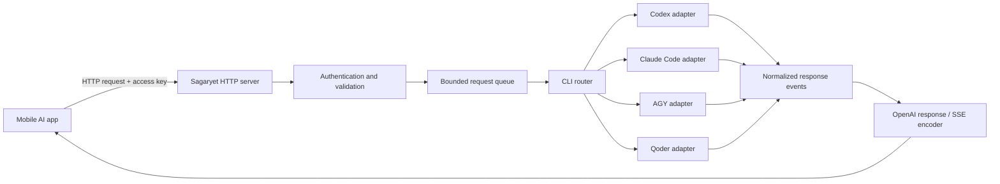

**Sagaryet will be a separate desktop app that turns an installed AI CLI into an OpenAI-compatible server.** You select Codex, Claude Code, AGY, or Qoder, start the server, and enter Sagaryet’s URL and access key into your mobile AI app.

Implementation status — October 25, 2026: **in progress; localhost and LAN address display development slice implemented**. No Sagar files were changed.

| Milestone | Current status | Remaining acceptance gates |
|---|---|---|
| 0 — Feasibility | All four installations and catalogs checked; Codex and Qoder live requests passed; login checks separated from generation | AGY safe text-only configuration; Claude live authentication; all-provider adversarial isolation/stream/history/cancel checks |
| 1 — Foundation | Tauri controls, authenticated Rust API, versioned UI preferences, shared bounded process execution and event contract, synthetic internal fixtures, bounded queue | OS credential-store integration; production connection limits |
| 2 — First real CLI | Codex App Server adapter, ephemeral config/thread, buffered and SSE translation, role/history serialization; real HTTP history test passed | Adversarial tool/extension checks and full installed-provider cancellation/error matrix |
| 3 — Mobile access | LAN binding, local IPv4 discovery, dual address display and unencrypted-transport disclosure implemented | Verified isolation for LAN, real phone/client checks |
| 4 — Other adapters | Claude and Qoder adapters implemented; Qoder live test passed with isolated config; AGY models visible but generation disabled | Claude authentication failure; AGY safe adapter; remaining full contract/live matrix |
| 5 — Reliability | One active/four queued, queue/generation deadlines, bounded events/output, rate limit, Cancel/Stop/disconnect cleanup, process-group tests | Connection caps; slow-client/OS shutdown stress tests; Windows process-tree verification |
| 6 — Release | macOS release binary/app bundle built; native discovery/picker inspected; CI matrix added | Signed packages, remote Windows/Linux jobs, actual mobile-client compatibility matrix |

The UI now shows all four CLI checks together (paths/versions, login, model counts, and live results), discovers supported effort values, and offers explicit quota-consuming **Test connection** and **Test all available connections** actions. `bun run check:clis` provides sanitized installation/login checks from the terminal without AI prompts. Synthetic transport is an internal test fixture and is absent from the provider picker. Keys remain memory-only. See [current verification evidence](docs/implementation-verification.json) and [feasibility](docs/feasibility.md).

Reproduce with `bun run test`, `bun run build`, and the installed/live commands in [README](README.md).

**1. Product workflow**

The main workflow should be:

1. Open Sagaryet.
2. Select an installed CLI.
3. Check its login status.
4. Select a model and supported reasoning level.
5. Choose **This computer only** or **Local network**.
6. Click **Start server**.
7. Copy the server URL and access key into a mobile app.
8. Send messages and receive streamed responses.

Example connection details:

```text
Selected CLI:  Qoder
Server status: Running

On this computer:
http://127.0.0.1:54321/v1

From your phone:
http://192.168.1.20:54321/v1

API key:
<Sagaryet-generated access key>
```

`0.0.0.0` means “listen on all IPv4 interfaces.” It is a binding address; the phone uses the computer’s actual LAN IP.

Your phone and computer must be on a network that allows communication between them. The computer must remain awake, Sagaryet must be running, and the selected CLI must have access to its provider.

**2. Scope of the first release**

The first release should provide:

| Feature | Initial scope |
|---|---|
| Desktop systems | macOS, Windows, Linux |
| CLI providers | Codex, Claude Code, AGY, Qoder |
| Active provider | One selected CLI at a time |
| Client interface | OpenAI-compatible Chat Completions |
| Responses | Streaming and non-streaming text |
| Conversation history | Supplied by the client on each request |
| Network access | Localhost or explicitly enabled LAN |
| Authentication | Sagaryet-generated bearer key |
| Model discovery | Available models from the selected adapter |
| Monitoring | Active requests, queue, timing, errors |
| Cancellation | Disconnect, timeout, or desktop Cancel action |

Defer images, audio, embeddings, file uploads, client tool calls, autonomous coding, public hosting, automatic failover, and the Responses API.

Describe the product as **“OpenAI-compatible text chat”**, with a published compatibility table. Avoid claiming support for the entire OpenAI API.

**3. Architecture**



Recommended stack:

| Layer | Proposed technology |
|---|---|
| Desktop shell | Tauri 2 |
| Interface | React + TypeScript |
| JS tooling | Bun |
| HTTP server | Rust Axum |
| Async runtime | Tokio |
| JSON and validation | Serde with explicit validation |
| Streaming | Server-Sent Events |
| Preferences | Small versioned local configuration file |
| Access-key storage | OS credential store where supported |
| Tests | Rust adapter fixtures and HTTP integration tests |

Run the HTTP server in Rust, independently of the React window. React manages controls and status through Tauri commands; it does not own request execution.

Keep Sagaryet in its **own repository, application identifier, configuration directory, and release pipeline**.

**4. CLI adapter design**

Each provider needs a dedicated adapter because its command flags, event formats, authentication behavior, and completion signals differ.

| Provider | Proposed integration | Required verification |
|---|---|---|
| Codex | App Server over local stdio | Initialization, text deltas, terminal completion, tool denial, cancellation |
| Claude Code | Headless structured streaming | Partial text events, result reconciliation, tools/settings isolation |
| AGY | Headless `stream-json` | Installed-version event format, terminal status, safe execution configuration |
| Qoder | Headless `stream-json` | Executable aliases, model discovery, partial events, quota errors |

Codex documents an App Server protocol for embedding its agent capabilities. Claude Code, AGY, and Qoder document programmatic or headless execution with structured output. These are suitable starting points, but each adapter still needs installed-version testing. Sources: [Codex App Server](https://learn.chatgpt.com/docs/app-server), [Claude Code programmatic usage](https://code.claude.com/docs/en/headless), [AGY headless mode](https://www.antigravity.google/docs/cli/headless/), [Qoder scripting](https://docs.qoder.com/cli/run-in-scripts).

Define one internal adapter contract:

```text
probe_installation()
check_readiness()
list_models()
capabilities()
start_request(request)
cancel(request_id)
```

Normalize provider events into:

```text
Started
TextDelta
UsageAvailable
Completed
Failed
```

Keep raw provider events internal. Mobile clients should receive consistent OpenAI-shaped responses.

Every adapter must declare capabilities, including:

- Genuine incremental text streaming.
- Model selection.
- System-instruction handling.
- Conversation-history handling.
- Reasoning-level selection.
- Token usage availability.
- Ability to disable tools and inherited extensions.

If a CLI only provides a final result, mark it as buffered. Do not split a completed answer into artificial chunks and present that as live provider streaming.

**5. OpenAI-compatible API contract**

Implement these endpoints first:

| Endpoint | Purpose |
|---|---|
| `GET /healthz` | Minimal server liveness |
| `GET /v1/models` | Models exposed by the selected CLI |
| `POST /v1/chat/completions` | Text chat, streamed or buffered |

Require authentication for model discovery and generation. Keep health responses free of account information.

Example request:

```json
{
  "model": "codex/MODEL_ID",
  "messages": [
    {
      "role": "system",
      "content": "Answer clearly and concisely."
    },
    {
      "role": "user",
      "content": "Explain SQLite transactions."
    }
  ],
  "stream": true
}
```

Model routing:

- The API and desktop list all available models for the chosen CLI. Clients send an exact model ID per request; no default alias is provided.
- Explicit IDs such as `qoder/<model-id>` refer to models exposed by the active adapter.
- Unknown models return an error.
- Requests cannot silently switch to another provider.

Compatibility rules:

| Input | Planned behavior |
|---|---|
| `messages` | Text-only conversation with validated roles and ordering |
| `stream` | Support `true` and `false` |
| `n` | Support `1` |
| Reasoning effort | Accept only when the adapter supports the requested value |
| Temperature, token limits, stop sequences | Forward only when reliable semantics are available; otherwise reject |
| Tools and tool messages | Reject in the first release |
| Image/audio content | Reject with a clear unsupported-feature error |
| Structured output | Defer until verified per adapter |
| Unknown parameters | Return a useful validation error unless explicitly documented as harmless |

Do not silently ignore parameters that materially affect generation.

Use standard Chat Completions response fields and SSE chunk structure. OpenAI documents streaming as incremental completion chunks; Sagaryet should test its output against that contract. [OpenAI streaming reference](https://developers.openai.com/api/reference/resources/chat/subresources/completions/streaming-events).

**6. Conversation handling**

Keep the initial API stateless:

- The mobile app sends the full conversation.
- Each request receives a fresh CLI session.
- Requests cannot inherit another client’s history.
- Sagaryet does not save prompts or responses by default.

Prefer native role-aware input where available. Where a CLI accepts only a prompt, use a documented conversation serialization format and test multi-turn behavior.

This translation cannot guarantee identical instruction hierarchy or behavior to a direct model API. Expose that limitation in the compatibility documentation.

Reject oversized conversations with a useful error. Do not silently discard older messages.

**7. Streaming and request lifecycle**

Each request should follow:

```text
Received → Validated → Queued → Running → Streaming → Completed
                                                   ↘ Failed
                                                   ↘ Cancelled
```

Implementation requirements:

- Generate one request ID and completion ID.
- Snapshot the provider/model configuration at admission.
- Read stdout and stderr concurrently.
- Decode split UTF-8 safely, including Myanmar characters.
- Parse bounded structured records.
- Emit only assistant answer text.
- Exclude diagnostics, tool events, and private reasoning.
- Reconcile final results without duplicating streamed text.
- Require the provider’s successful terminal event.
- Bound output buffering for slow clients.
- Terminate the process tree when cancelled.

For successful streams: send the assistant role, text deltas, final finish reason, and `[DONE]`.

For failure after streaming starts: send a documented error payload when possible and close the stream without a successful finish marker. Some mobile clients may show this as an interrupted response; test their behavior explicitly.

Do not automatically retry after output begins. That can duplicate responses and provider usage.

**8. Server and network behavior**

Provide two explicit modes:

| Mode | Binding | Intended use |
|---|---|---|
| This computer only | `127.0.0.1` | Desktop clients |
| Local network | `0.0.0.0` | Phone/tablet on the LAN |

For random ports, bind to port `0` and read the assigned port from the same listener. Avoid finding a free port and reopening it later.

Offer an optional fixed port because mobile clients otherwise need a new URL after some restarts.

Show:

- Localhost URL.
- Candidate LAN addresses and interface labels.
- Copy URL action.
- Port and network mode.
- Clear status when an IP changes.
- Troubleshooting for firewall rules, guest Wi-Fi isolation, VPNs, and sleeping computers.

Do not create router port forwarding or public tunnels automatically.

A QR code may contain the URL. Including an access key should require an explicit “Include access key” choice.

**9. Authentication and execution safety**

The LAN server can spend the user’s CLI quota and invoke installed software, so these controls belong in the first usable build:

- Generate a cryptographically random access key.
- Require `Authorization: Bearer <key>`.
- Support key rotation and invalidate the old key immediately.
- Never place keys in query strings or ordinary logs.
- Keep desktop administration available only through Tauri commands.
- Disable browser CORS access by default; allow explicit origins if needed.
- Apply request-size, queue, connection, and rate limits.
- Validate host headers against configured addresses.
- Spawn fixed executables with argument arrays.
- Never expose arbitrary commands, executable paths, or CLI flags through HTTP.
- Prefer stdin/protocol input for prompts where supported.
- Use isolated temporary working directories.
- Disable tools, hooks, plugins, MCP servers, and inherited project instructions where supported.
- Reject interactive approval requests.

An empty working directory alone is not a sandbox. An adapter should remain unavailable for LAN use until its safe text-only configuration has been verified.

HTTP LAN mode should clearly disclose that traffic and the bearer key are unencrypted. Plan HTTPS with user-provided certificates, or access through an existing trusted VPN, for stronger transport protection. Mobile clients that require HTTPS must be identified during compatibility testing.

**10. Desktop interface**

Use a compact main window with four areas:

| Area | Contents |
|---|---|
| Provider | CLI picker, executable/version, login/readiness, model, reasoning |
| Server | Network mode, random/fixed port, Start/Stop, status |
| Connect | Base URL, masked key, reveal/copy/rotate, connection instructions |
| Activity | Active requests, queue, duration, completion/error, Cancel |

Useful provider states:

```text
Not installed
Detected
Authentication required
Ready
Unsupported CLI version
Quota exhausted
Unavailable
```

Useful server states:

```text
Stopped
Starting
Running
Stopping
Failed
```

Add a synthetic **Test response** action. Make clear that it sends a small request and may consume provider quota.

Show request metadata by default, without prompt or response bodies. Any diagnostic export must redact credentials and sensitive content.

When requests are active, changing providers should wait until the queue is drained or the user explicitly cancels them. Prevent queued work from unexpectedly using new settings.

**11. Reuse from Sagar**

The repository already contains relevant patterns in:

- [CLI discovery and model handling](/Volumes/X9_2TB/Github/sagar/src-tauri/src/services/ai.rs)
- [Process execution and stream parsing](/Volumes/X9_2TB/Github/sagar/src-tauri/src/services/ai_translate.rs)
- [Codex App Server integration](/Volumes/X9_2TB/Github/sagar/src-tauri/src/services/codex_stream.rs)
- [Qoder integration](/Volumes/X9_2TB/Github/sagar/src-tauri/src/services/qoder.rs)

Reuse discovery, environment handling, parsing fixtures, and cancellation lessons after reviewing their dependencies.

Keep EPUB translation prompts, XHTML validation, book persistence, and Sagar’s domain errors out of Sagaryet.

Sagar’s current plan also records that successful live Qoder generation remained unverified after a quota error. Treat that adapter as a starting point requiring validation.

**12. Implementation milestones**

| Milestone | Work | Acceptance criteria |
|---|---|---|
| 0 — Feasibility | Probe all four installed CLIs with synthetic input; record versions and capabilities | Each provider has an evidence-backed capability matrix; unsafe or unsupported configurations are identified |
| 1 — Separate foundation | Create Sagaryet repository, Tauri shell, configuration, Rust server, fake adapter | Start/stop works; random port works; authenticated HTTP and synthetic streaming pass |
| 2 — First real CLI | Add Codex adapter and text-chat conversion | Streaming, non-streaming, multi-turn context, cancellation, and errors work end to end |
| 3 — Mobile access | Add LAN mode, addresses, key controls, connection guide | A real phone discovers models and receives streamed text |
| 4 — Remaining adapters | Add Claude Code, AGY, and Qoder | Each passes the same contract suite and a successful live synthetic request |
| 5 — Reliability | Add bounded queue, timeouts, backpressure, shutdown and process cleanup | Disconnects, quota failures, hangs, and concurrent clients leave no orphan processes |
| 6 — Release | Package for three desktop systems; test selected mobile clients | Publish verified OS/CLI/client combinations and known limitations |

Use one active generation at a time initially, with a small bounded queue. Make higher concurrency a later capability backed by provider testing.

**13. Verification plan**

Before release, verify:

- Missing/invalid access keys never launch a CLI.
- Unknown models and unsupported parameters fail clearly.
- Streaming works through a real mobile client.
- Buffered and streamed answers agree.
- Multi-turn history stays isolated between clients.
- Split JSON records and Myanmar UTF-8 decode correctly.
- Final provider events do not duplicate text.
- Login expiry, quota exhaustion, malformed output, and process crashes map to useful errors.
- Disconnect, Cancel, Stop, and app exit clean up child processes.
- Slow clients cannot cause unbounded memory growth.
- CLI tools, hooks, and extensions cannot execute during text-chat requests.
- Windows executable shims and process-tree termination work.
- Normal/minimum window sizes, keyboard access, and light/dark themes work.

Document provider-account restrictions and supported automation usage before distribution. Using a CLI does not establish unlimited usage or permission to redistribute account access.

**Next acceptance work:** establish complete tool/hook/plugin isolation for every enabled adapter (AGY remains generation-disabled), restore Claude live authentication, then validate the Codex → phone → streamed response → cancel slice on a real phone. Finish all-provider contract and cross-platform release verification before marking milestones 0–6 complete.
